# Android vs iOS: the side-by-side audit (LIME-421)

Written by tend-Android on the design night of 2026-11-13. **Read-only: nothing was fixed.** Purpose: so you can choose, screen by screen, what Android should match, what is small, and what should stay different on purpose.

## How it was made (and what to trust)
- **iOS:** the Swift source in `ios/Lime/**` (read only; the file and line are in each row), plus screenshots. **Most iOS screens are "source only"**: no iOS shot exists for them and no simulator could be driven (the two booted simulators were running tend-iOS's UI tests, which only ever showed the welcome screen; I never booted, built or installed anything there). The iOS shots used: `docs/design/mobile/*.png` (messages, chat, composer, format menu, settings, profile, call mini-player; **dated 2026-10-04: an OLDER iOS design in another font and a different header, so a "(dated)" shot shows the idea, the Swift source is the truth**), and two current frames from the booted simulator (welcome, a "Keep this post?" sheet).
- **Android:** real screens rendered by `AuditShotsTest` with sample data on the API 36 emulator (`tools/shots-audit.sh`): light, some dark and 200% font; the raw shots are in `~/Desktop/lime-android-design/audit-raw/`, downscaled copies (each under 300 KB) in `docs/design/android-audit/`. Group info shows its loading state (nearly blank); the empty Messages shot shows an empty list.
- **Rows were drafted by four reading agents** (Messages and chats; composer and messages; jam, bands and profile; settings, onboarding, shell) and I spot-checked the load-bearing claims (chat header items, send-button colour token). Cells say "unverified" where the reader did not confirm; treat numbers as "read from the code, not measured on a device".
- **Verdicts:** `match`; `small` (under an hour); `medium`; `large`; `native` (Android should differ on purpose). New tonight (LIME-420) and not used by any screen yet: `ui/theme/LimeType.kt`, `LimeShapes.kt`, `LimeSpacing.kt`, `LimeComponents.kt` (`LimeCircleButton`, `LimeTopFade`).

## Counts by verdict (62 rows)
**match 1 · small 26 · medium 14 · large 14 · native 7.**

## The 10 differences that most change the feel (ranked by what I see)
1. **Headers.** iOS floats circle buttons (back, search, actions) over the content with a soft top fade, and the Messages header is the lime logo plus a search-and-avatar bubble; Android has a text "lime", plain icon buttons and a solid bar, and the chat header is just back, avatar and a 20 sp name (iOS adds the status line, search and call circles). *(A, D; 422)*
2. **The tab bar and shell.** iOS: a floating pill with link / jam / call; Android: a full-width Material `NavigationBar`. Keep Material's semantics but restyle (canvas, hairline, neutral active state). *(D; 422; partly native)*
3. **Chat list rows and the "+".** Close already (22 vs 20 dp rhythm aside), but iOS has full-swipe Read/Unread and Pin, a 64 pt plus; Android a 56 dp FAB with a pencil and swipe-right read only. *(A; 422)*
4. **Reactions and the long-press menu.** iOS: 30 pt chips overlapping the bubble edge, a full emoji picker, a reactors sheet, a lifted bubble with icon menu; Android: pills under the bubble, a text-only sheet. *(B)*
5. **Type scale.** Android's body is 16 sp (iOS 17); 14 sp and 16 sp and 20 sp titles have no iOS style; screen titles are 20 sp (iOS inline headline 17). The tokens from LIME-420 fix it as a sweep. *(B, all)*
6. **Settings.** iOS: grouped icon rows with chevrons opening sub-screens (Account, Privacy, Customize, ...) in 24-radius cards; Android: one flat list in 20-radius cards. Customize depth (backgrounds, text size, typeface) and the multi-step delete-account flow are missing. *(D)*
7. **Profile and band heroes.** iOS: a tall hero (58 % of the screen), a lime-shaped avatar, tabs, shared items; Android: a centred 96 dp circle on a plain canvas; the band page has no cover. Group info is the same story. *(A, C)*
8. **Jam articles and the reader.** iOS: cover cards, a floating action pill, an article font picker; Android: plain text cards and a reader with one grey byline. *(C)*
9. **Sheets and dialogs.** iOS: custom 28-radius sheets with pill buttons; Android: Material `AlertDialog`s and full-screen dialogs. One `LimeSheet` would change the feel of ten screens. *(D)*
10. **Onboarding frame.** iOS: the lime-slice logo and a Next capsule, field radius 16, button 54; Android: a "lime" wordmark at 72 sp, a 56 dp Next circle, field radius 14. *(D; small)*

**Features iOS has that Android lacks entirely (not look, but you will notice):** in-chat find; the call mini-player (calls are not built); thread replies with a composer and reactions (Android's thread is read-only); text size and typeface settings and chat backgrounds; Drafts and Discover in jam; band review queue; covers and co-authors in compose.

## Recommended order of per-screen briefs
1. **LIME-422 (planned tonight): shell, headers, chat list** (items 1 to 3): do the header circles and top fade everywhere a header appears in one pass if time allows.
2. **Chat screen:** header (status line, search and call circles), message text 17 sp, send button token, reactions and the long-press menu (items 4 and 5 for chat).
3. **Token sweep:** replace the off-scale sizes and radii (14/16/20 sp, 26 and 8 dp) with `LimeType`/`LimeShapes` across `ui/` (mechanical, visual-only).
4. **`LimeSheet`** and the confirm dialogs (item 9).
5. **Settings restructure + Customize** (text size, typeface, background: first a design check with you, then the core already has theme rules) (item 6).
6. **Profile, band and group heroes** (item 7).
7. **Jam chrome, article cards, reader** (item 8).
8. **Onboarding polish** (item 10: small).
9. **Missing features as their own briefs:** in-chat find, thread parity, delete-account flow, the call mini-player with the calls build.

## What should stay different on purpose (`native`)
System back and predictive back (no edge-swipe back); ripples and Material dialogs' focus and TalkBack behaviour; edge-to-edge system bars; no Liquid Glass (a solid surface with the hairline instead); the platform keyboard and IME handling; the bottom sheet for message actions as the Android pattern (add icons, keep the sheet); a real `NavigationBar` for the tab bar's semantics. The staff moderation queue is not on Android.

## The rows
| Screen | iOS file | iOS shot | Android shot | Layout | Shape | Type | Colour | Motion/feedback | Behaviour | Verdict |
|---|---|---|---|---|---|---|---|---|---|---|
| Messages (chat list) | Features/Messages/MessagesView.swift:85-118 (header), :166-170 +Common/FilterRow.swift:30-47 (filters), :702-766 (row), FloatingPlus.swift:8-46 | 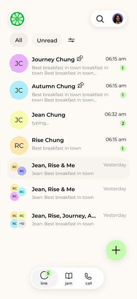 | 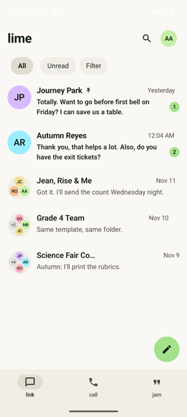 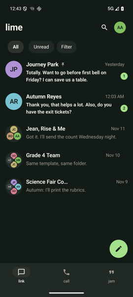 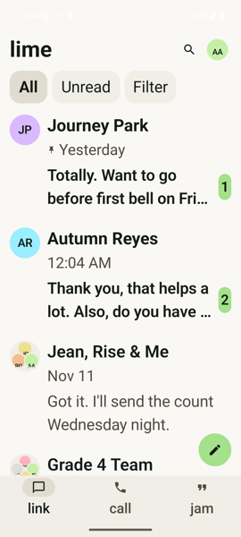 | iOS header: 30pt logo left, search+avatar(30pt) in one glass bubble right. Android: "lime" wordmark text, search 48dp, avatar 36dp, no glass. Row: avatar 52 (max 64), gap 12, pad H16 V15, 34pt preview thumbnail; Android 52/12/16/15, no thumbnail. | Filters: iOS segmented All/Unread (max 220pt) + 44pt glass circle icon with badge; Android three 18dp-radius pills (All/Unread/Filter). Plus: iOS 64pt glass circle; Android 56dp solid circle. | Name body semibold/bold unread (17); time subheadline (15), Android 14sp; preview subheadline 15, 2 lines, same. Wordmark: iOS image, Android 28sp bold. | Badge, preview, pin/mute grey: same tokens. iOS plus = accent at 55% tint over glass; Android plus = solid accent, pencil icon. Selected chip: pressed (warm neutral) both. | iOS soft top scroll edge (TopFade/system); Android none (LimeTopFade unused). iOS plus lifts above mini-player and glass reacts; Android ripples (themed: unverified). | iOS swipe: leading Read/Unread (blue, full swipe) + Pin; trailing Delete red, Mute orange, Leave grey. Android: swipe right = Read/Unread, swipe left or long-press = actions sheet; no coloured buttons. iOS plus long-press = Emergency menu; Android none. | medium: header, filter control, plus, swipe buttons. Ripples, sheet and no glass are native: native |
| Messages empty | MessagesView.swift:464-515 | source only | 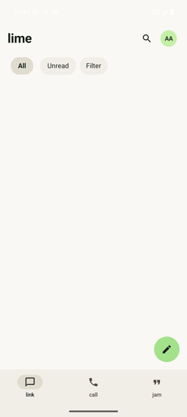 | Top pad 48, H12; title block spacing 6; cards spaced 12, pad 16; Android cards spaced 20, pad 14, min 72dp. | Cards radius 20 continuous; Android 16dp. Card icon circle 48, same. | Title title2 bold (22); Android 24sp bold. Subtitle body; Android 16sp. Card title 17 semibold, detail 15: same. | Cards on surface, accent icon circle with accentInk: same. | none either (unverified on Android). | iOS Find card opens Search; Android Find opens New message (same as New message card). Invite shows "coming soon" note on Android. | small |
| Requests | MessagesView.swift:424-461 (list row), Messages/NewMessageSheet.swift:648-685 (screen) | source only | 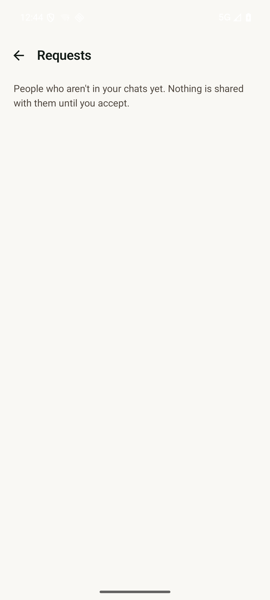 | Row: 52 circle, gap 12, pad H8 (+12 inset) V12; Android H16 V12, min 72dp. Screen: system inline title + glass back; Android custom 64dp bar, back 56dp, explainer pad 20/8 same. | Row icon circle 52 and count capsule: same. Rows inside screen get H12 inset; Android none. | Title body semibold, sentence subheadline, count caption semibold; Android 17sp semibold / 15sp / 12sp. Screen title: iOS system inline; Android 20sp semibold. | Accent circle + capsule, text/secondary: same. | iOS refreshable; Android none on Requests (unverified). iOS pops back when last request answered. | iOS rows open chat with Accept/Block bar; Android same via RequestBar (ChatScreen.kt:488). Auto-pop when empty: Android unverified. | small |
| New message | Features/Messages/NewMessageSheet.swift:126-200 (sheet), :330-480 (header, rows, A-Z rail, field) | source only | 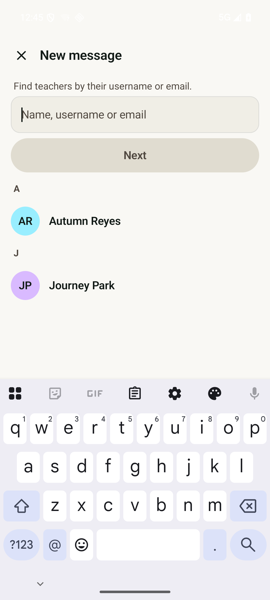 | iOS: large-detent sheet, header title + 44pt glass X, pad H16 T14 B10; Android full screen, 64dp bar, X 56dp. Row: 44 avatar, min 60, H20; Android min 64, H16, gap 14. | Field: radius 14, min 52, surface fill; Android OutlinedTextField radius 14, min 56, hairline border. Next: iOS accent capsule 44 high (40% when off); Android full-width neutral button. | Header headline semibold (17); Android 20sp semibold. Row name body 17 regular; Android 17sp semibold. Letter headings: iOS A-Z rail 11pt; Android inline 14sp bold. | Accent only on Next (iOS); Android Next neutral until valid. Field surface vs Android surface+hairline: same family. | Android keyboard IME search key; iOS no motion noted. iOS rail drag jumps to letter. | iOS has Scan QR Code row (56 min), A-Z jump rail (44pt wide); Android has neither. Both: exact lookup on Next, tap result opens chat, New group row. | medium: QR row and rail missing, sheet vs full screen. Sheet/IME differences: native |
| Search | Features/Search/MessageSearchScreen.swift:311-341 (bar), :150-300 (results) | source only | 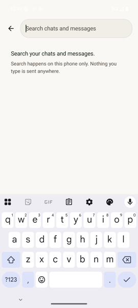 | Bar: iOS 48pt glass back + glass capsule field min 48 with magnifier and 44pt clear; Android 56dp back + OutlinedTextField min 56, no leading icon (unverified), no clear. Privacy hint: iOS centred, lock icon 28pt, pad T60; Android left, pad 32. | Field: iOS capsule; Android 26dp radius (close). Rows: avatar 44, pad H8 V10; Android H16 V8 min 64. | Row title body-semibold 17, section heading subheadline semibold; Android 17sp/16sp semibold, section 14sp bold. Snippet subheadline 15, 2 lines: same. | Secondary text, surface: same. | iOS glass bar; Android none. | iOS sections: calls, people, jam, chats, messages + exact teacher lookup + Invite; Android chats and messages only (others unverified). iOS hit opens thread or message highlight; Android same. | medium: sections and lookup. Glass: native |
| 1:1 chat | Features/Chat/ChatView.swift:121-153 (iOS 26 header), :355-382 (rows), :895-935 (row), :1030-1044 (bubble), :1095-1101 (state) | 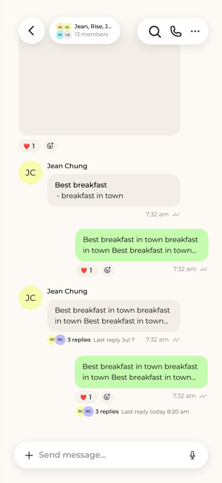 | 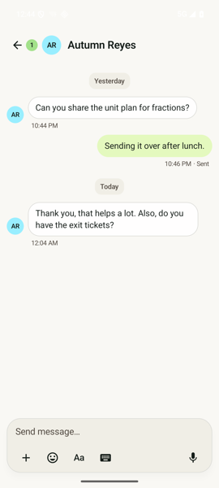 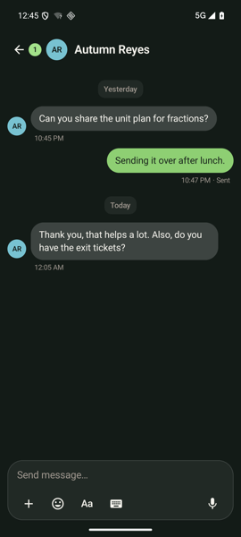 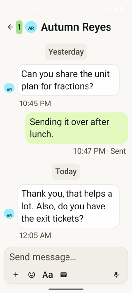 | Row side pad iOS 20; Android 12dp. Own spacer min 56 vs Android max width 78% of screen. Header: iOS system back (glass) + avatar 36 + name, search and call 44pt glass circles; Android arrow 56dp + unread pill, avatar 36, no search/call. | Bubble radius 22, pad 14/10: same. Other bubble edge 0.5pt; Android 0.8dp. Own none: same. Day label: iOS plain caption, capsule only over wallpaper (8/2); Android always 12dp-radius chip 10/4. | Header name iOS subheadline semibold (15) + caption status/label; Android 20sp semibold, no sub-line. Day: caption medium vs 13sp medium. Delivery 12sp, "· Sent" (iOS footer font unverified). | Bubbles: own/other/bubbleEdge tokens same. Chat wallpaper and per-chat colour (ChatLook) on iOS; Android none (unverified). | iOS soft top/bottom scroll edge, glass composer (radius 22/26); Android solid card with hairline and shadow 6dp. Avatar 36 (max 48) vs 32dp. | State shown on last own or unsettled: same. iOS time only at end of run: same. iOS select, find, reactions pill, thread row with avatars; Android thread row text only "N replies" 14sp. | medium: header actions, side padding, wallpaper. System back, no edge-swipe: native |
| Group chat | ChatView.swift:895-935, :447-451 (group subtitle), :459-463 (tap) | source only | 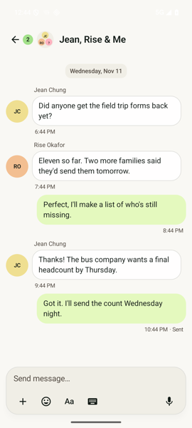 | Same as 1:1. Sender avatar iOS 36 (max 48), Android 32dp. Sender name above bubble: iOS spacing 4; Android start pad 4, bottom 2. | Bubbles same (22, 14/10). Avatars circles both. | Sender name iOS caption medium; Android 13sp regular. Header: iOS name subheadline + caption member subtitle; Android 20sp, no subtitle. | Sender name Theme.text (iOS) vs textSecondary (Android). Avatar pastels same 8 tones. | Same as 1:1. | Name on first of run: Android yes; iOS rule unverified. Tap avatar = profile on both. | small |
| Chat header and info | ChatView.swift:423-475 (title pill), :459-463 (tap) |  |  | iOS: avatar 36 + name + caption status/label/subtitle, left-aligned in width screen-196; Android avatar 36 + 20sp name, fills row, min 48dp. | iOS legacy header: glass pill, radius capsule; iOS 26: no pill. Android no pill. | Name subheadline semibold (15) vs 20sp semibold. Status caption (iOS) vs none. | Secondary caption (iOS); verified seal icon grey 13pt on iOS; Android none (unverified). | Tap: iOS opens profile or group via nav push; Android same, ripple. | 1:1 tap = profile (iOS ProfileRoute, own = my profile); Android onProfile. Group tap = group details; Android same but not once ended. "Verified in person" seal + alert: iOS only. | small |
| Group create: picker | Features/Groups/GroupScreens.swift:36-124 | source only | 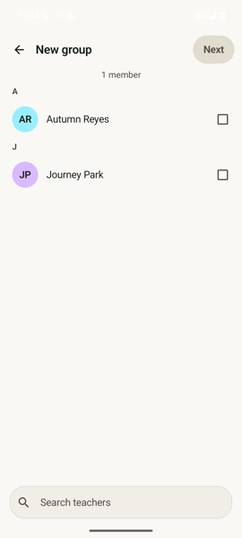 | iOS: SheetHeader (glass back, title, Next capsule 44), count centred, chip row H16 V8, rows min 60 H20, search bottom capsule min 52; Android 64dp bar, Next pill min 48, rows min 60 H20, search min 56 at bottom. | Next: capsule accent (40% disabled) vs Android 24dp-radius neutral pill when disabled. Chips: avatar + first name + xmark, min 44 vs Android 48 with 26dp avatar, 24dp radius. | Row name body 17; headings subheadline semibold (15) vs Android 14sp bold. Count secondary vs 15sp. | Checkbox: iOS circle icon 24pt (text colour on, secondary 60% off); Android square box icon 24dp. Android disabled Next uses pressed neutral. | iOS announces count to VoiceOver; Android unverified. | Needs-key row "New key: accept first" and warning icon on iOS; Android unverified. Same two-step flow. | small |
| Group create: name + emoji | GroupScreens.swift:143-224, Groups/GroupAvatarEditor.swift:11-50 | source only |  | iOS: 96pt avatar circle (emoji 48pt), Emoji/Photo segment, name field min 52, counter, member row 44pt avatars in 56 columns, pad 20, spacing 18; Android: no preview circle, two outlined fields min 56, avatars 44 in 64x72, spacing 14. | Field radius 14 both; iOS filled surface, Android outlined with floating label. | Counter caption (12) vs 13sp; member names caption vs 13sp. | Surface fill vs outline hairline. | iOS photo crop (circular); Android none. | iOS name defaults from members and tracks until edited; Android unverified. iOS photo mode (choose/take); Android emoji only (8 chars). | medium: avatar preview and photo |
| Group info | Features/Groups/GroupDetailsView.swift:146-234 (toolbar), :246-267 (hero), :319-355 (rows) | source only | 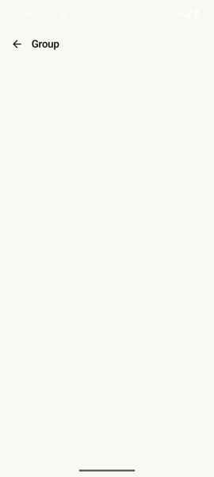 | iOS: cover hero, avatar 104, white name title2 semibold + count over cover, rows min 58 with 20pt icons and hairline dividers inset 60. Android: 104dp avatar centred, name 24sp, count 15sp, cards min 56, member rows min 60. | iOS hero cover shape (HeroShape); Android none. Rows: iOS divider list; Android 16dp-radius cards. | Name title2 semibold (22) vs 24sp; count subheadline vs 15sp; rows body 17. Section heading 14sp bold on Android. | iOS white on cover scrim; Android text on canvas. Danger red both (Theme.danger). | iOS Edit/Done mode, camera badge; Android none. | iOS toolbar: paintbrush (cover), Edit, More menu (Mute, Pin, Chat appearance, Add, Delete, Clear, Leave, Report), shared media; Android rename, add, remove, leave, report in AlertDialogs (Mute/Pin/media unverified). | large: cover hero, edit mode, shared media, mute/pin |
| Thread (replies) | Features/Chat/ThreadView.swift:20-84, :291-306 | source only | source only (no thread screenshot) | iOS: root bubble + "N replies" hairline row + replies in the full chat bubble, pad H20, bottom 16 each; Android: root as grey 15sp text, replies spaced 8dp, pad 12. | iOS bubbles 22 radius, pad 14/10; Android 18dp radius, pad 12. | iOS Theme.body in bubbles, header caption semibold count; Android 16sp replies, 15sp root. | Own/other tokens same. | iOS animated scroll to hit, "Show N earlier" button (44pt). | iOS full thread: composer, reactions, edit, find, select, actions; Android read-only ("tonight"). iOS windows older replies; Android lists all. | large: read-only, no composer or actions |
| Composer closed (card, attach, emoji/GIF, Aa, keyboard, mic/send) | Features/Chat/ChatComposer.swift:74-167 | 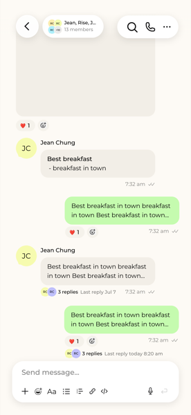 |  | iOS tool buttons 44x44, card pad 12/2/4 inside 12 outer; Android 48x48 buttons, same 12/2/4 pad. Row order same: + face Aa keyboard, mic/send right | iOS 26pt continuous glass card (limeGlass); Android 26dp card, 1dp hairline, 6dp shadow, no glass | iOS placeholder Theme.body 17 "Send message…"; Android 17sp, 24sp line. Aa 17 medium/bold same | iOS card = system glass over canvas; Android flat surface (F0EEE6). iOS mic is "waveform" glyph; Android mic in 56dp surface circle (shot shows bare mic) | iOS easeOut 0.2s on strip/emoji; selected tool gets pressed capsule (both). Android ripple unverified | iOS 😊 opens panel (Emoji/GIFs/Stickers), Android face opens GIF sheet; iOS "+" opens AddSheet, Android attach-sheet | small: 48 vs 44 targets are fine; match card fill and mic glyph |
| Composer open / typing (growing field, send, reply bar, edit bar) | ChatComposer.swift:74-100,150-167,430-456 |  | 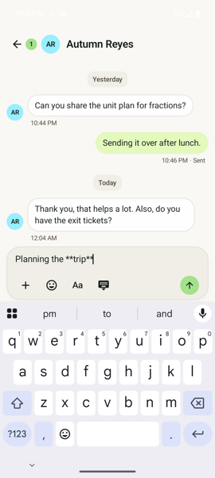 | iOS field capped by model.fieldCap, expand button 44x44 over 5 lines; Android min 48, cap from window, expand 48x48 (mirrored as iOS) | iOS send: 36 circle in 44 target, arrow.up 18 semibold; Android 36 circle in 48, 20dp arrow. Reply/edit bar Android: 12dp chip, 13sp two lines | Android reply/edit bar 13sp semibold + 13sp; iOS reply bar font unverified | iOS send fill = Theme.primary (OwnBubble E4F9BE); Android send fill = accent A3E18A (shot shows strong green) | iOS send appears with Haptics.tick on mic; Android no haptics found in chat/*.kt | Same: send replaces mic when text or draft; edit hides + and face (Android) - iOS edit behaviour unverified | small: send colour token, bar fonts |
| Formatting toolbar / format menu | Features/Chat/Composer/FormattingToolbar.swift:10-95 | 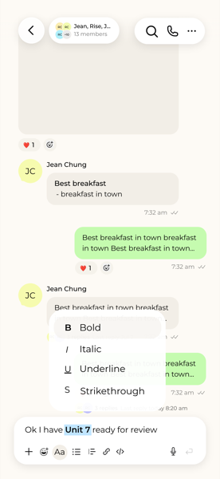 | 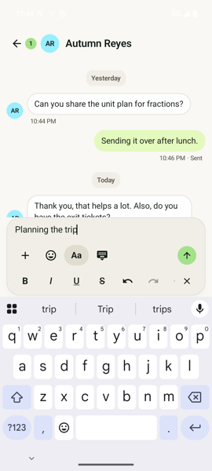 | iOS: separate glass capsule min 46 high + 46 circle X, above keyboard; Android: strip inside the card under tool row, 48 buttons, scrolls sideways | iOS capsule + circle glass; Android no own container, pressed circle 44 (48-2x2) | iOS B 18 bold, symbols 17, H1-H6 15 bold; Android letters 18sp, icons 22dp | iOS on = Theme.pressed capsule; Android pressed circle (same token) | iOS fade 0.2s; Android none found | iOS has quote, headings, Button (rect+hand), link/code/lists; Android has B I U S, undo/redo, link, code, lists, indent (no quote/headings by LIME-404, no Button) | medium: separate floating bar and extra tools differ |
| Message bubbles (shape, colours, grouping, time, delivery, group avatars) | Features/Chat/ChatView.swift:824-1112,1030-1045 |  |   | iOS pad 14/10, row bottom 16, avatar 36 (scales, max 48), gutter time reveal 64; Android pad 14/10, row pad 2, avatar 32 + 8 gap, max width 78% | Same radius 22; iOS other edge 0.5, Android 0.8dp; both none on own | iOS Theme.body 17 (Dynamic Type); Android message text 16sp fixed default; footer iOS caption, Android 12sp | Same tokens: own E4F9BE/8ECF73 dark, other FFFEFE/3D4441, ink 131B17 | iOS highlight animates 0.2s for find; Android none | Time only at end of run/state/edited both. iOS also swipe-to-reveal time; Android none found. Delivery words same ("· Sent") | small: type size 16 vs 17, swipe time, edge width |
| Message text styling (links, mentions, code, lists) | Features/Chat/MessageText.swift:28-100,195-225 | source only | source only | iOS list indent 18/level, marker min 14; Android 16/level, marker 24 wide. iOS headings title..footnote bold; Android body+2..6 | Code block iOS r10, pad 10, ink 10% fill, callout mono; Android r8, pad 8, chip fill, size-1 mono | iOS body 17; Android 16sp. Mention both bold | Link: iOS LinkOwn/LinkOther + underline; Android linkColor + underline. Inline code iOS ink 12% bg, Android none | iOS pressed link tint 22%; Android none | iOS auto-links bare URLs and has quotes with italic dim; Android quote = 3dp bar (bare-URL linkify unverified) | small: inline code bg, sizes |
| Reactions (chips, quick-react picker) | Features/Chat/ReactionCluster.swift:3-120; MessageActions.swift:346-380 | source only | 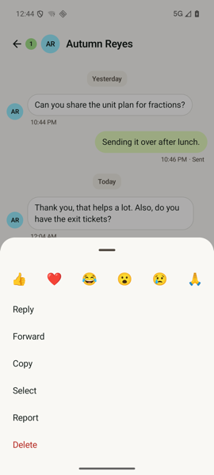 | iOS: round 30pt chips overlapping 7, on bubble bottom edge, max 6 then "+N", count badge; Android: pill row under bubble, gap 6, min 48 hit | iOS circle 30; Android r14 pill, pad 8/3 | iOS emoji 16 (max 22), badge caption2 bold; Android emoji 14sp, count 13sp | iOS mine = accent fill; Android mine = own bubble color, others surface | iOS glass row, 6 emoji 44x44 + plus, spring 0.3; Android sheet row 48 circles, emoji 24sp, no plus/more | Android has no "more emoji" picker or reactors list (iOS: React sheet + Reactions sheet, search all emoji) | large: visual model and missing full picker/reactors |
| Message actions (long-press menu) | MessageActions.swift:154-300,383-430 | source only |  | iOS lifts the bubble, shows reaction row above and a menu (width scaled, 48 rows, symbols leading); Android modal bottom sheet, 52dp text rows, no icons | iOS menu r18 canvas + 0.5 hairline, shadow 18; Android sheet default top radius | iOS body 17 + SF symbol; Android 17sp text only | Delete danger both (B3261E / FF8A80 dark) | iOS 0.4s hold, spring 0.3 (0.12 reduced motion), haptic; Android long-click, sheet slide | Same actions in same order: React Reply Forward Edit Copy Save GIF Select Report Delete. iOS Delete = confirmation dialog; Android AlertDialog | native: bottom sheet is Android's pattern; add icons small |
| Link preview card | Features/Chat/LinkPreviews.swift:131-152 | source only | source only | Both 248 wide, image ratio 1.9, text pad 12/9 | iOS r18 continuous; Android r16 | iOS title subheadline semibold (2 lines), site caption; Android 15sp semibold, 13sp | iOS own = own fill, other = bubbleOther + edge 0.5; Android always surface + 0.8 hairline | none found | iOS no-visit design same; Android asks before non-https | small: radius 16 vs 18, own-card colour |
| Voice messages and file cards | Features/Attachments/VoiceMessages.swift:301-362; AttachmentViews.swift:224-254 | source only | source only | iOS voice: own bubble, pad 10/8, 44 play (40 circle), wave 112x28, time caption, speed pill pad 6/1. Android: no bubble, 220-260 wide, 48 play, wave 36 high, time 14sp. File: iOS 248 wide pad 14/10, Android 200-260, 28 icon | iOS r22 bubble around voice/file; Android none (sits in the message bubble) | iOS file name body 17 one line; Android 16sp semibold 2 lines | iOS play disc ink 16% / surface; Android bare icon ink | iOS speeds 1/1.5/2 pill visible always while current; Android only while playing | Same speed cycle and seek; iOS TransferRing, download arrow; Android text state | medium: card container and play disc |
| Video messages | Features/Attachments/VideoMessages.swift:100-144 | source only | source only | Both 248 wide, ratio clamp 0.6-1.8, 52 play disc black 45% | Both r18 | Duration caption semibold mono (iOS) vs 12sp semibold; size chip r10 both | Same | iOS TransferRing 44; Android spinner 28 | Android recorder: full screen, 72 shutter; iOS recorder not examined (unverified) | match |
| GIF panel | Features/Chat/Composer/ComposerPanel.swift:31-200; GIFLibrary.swift:155-190 | source only | source only | iOS: panel on keyboard area with grabber 36x4, tabs Emoji/GIFs/Stickers, 3-col grid 12 pad, thumbs 84 in search row; Android: modal sheet, tabs GIFs/Stickers, 3-col (stickers 4), gap 8, max 420 | Thumb r12 both; iOS search capsule 40; Android outlined field, tab pill r24 | iOS body/secondary; Android 15sp | Same surface tokens | none found on either | iOS has emoji tab and slash strip; Android has GifSlashStrip (72 thumbs, r12, same as iOS 72) | native: sheet vs keyboard panel; emoji tab is large (system keyboard on Android) |
| Mention panel | Features/Chat/Composer/Mentions.swift:73-108 | source only | source only | iOS rows min `row`, pad 16/6, avatar 32; Android row 52, pad 16/6, avatar 32, spacing 10, up to 5 rows | iOS r20 glass; Android r20, surface fill, 8dp shadow | iOS name body 17, second secondary; Android 17sp / 14sp | Glass vs surface F0EEE6 | none found | Same: floats above composer, @everyone row with People icon | small: glass vs flat only |
| In-chat find | ChatView.swift:165,530-560 | source only | none | iOS find bar under header (top pad 62), "Find in chat", 150ms debounce, matches highlighted (FindMatch/FindCurrent), start at newest | Search field in glass | body 17 | FindMatch, FindCurrent, FindInk tokens | highlight fades 0.2s | Android: no find in chat found (grep of ui/chat/ChatScreen.kt, ui/ for findBar: none) | large: whole feature missing |
| Jam feed (header, filter, cards, subscribe empty state) | Features/Jam/JamPage.swift:132-181, JamFilter.swift:60-112 | source only | 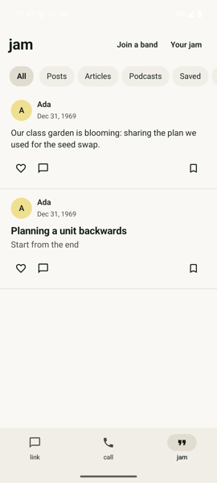 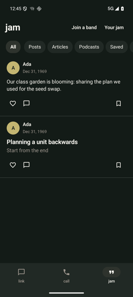 | iOS: no title row, glass circle controls over list (top margin 76), filter row under it, divider per card, bottom pad 32+plus. Android: "jam" title 28sp row min 64dp + "Join a band" / "Your jam" text buttons. | iOS selected segment = glass capsule, 44pt tall. Android: 18dp rounded pill, every pill has a surface fill, 48dp. | iOS segments subheadline (15) semibold when on, grey when off. Android 15sp, bold when on, always dark text. | iOS: unselected pills have no fill. Android: surface fill for all, `pressed` for selected. | iOS: 16pt edge fades on the scrolling row, highlight fade 0.4s, skeleton cards while loading. Android: pull-to-refresh, no fades/skeleton. | iOS: Drafts and Discover segments, filter menu button fixed at right, page of 20. Android: Saved + Filter as pills in scroll row, bottom sheet; no Drafts/Discover; no paging. Empty text same (17sp, 40 side, top 120 vs 80). | medium: header and filter chrome differ, glass capsule has no Android equivalent |
| Post cards (quick post, article, podcast, photo) | Features/Jam/JamPage.swift:195-260, 360-420; JamArticle.swift:107-160; JamPodcastCard.swift | source only |  | Both: 20 side / 14 vertical, 10 spacing, 40 avatar. iOS article = full cover card (photo or tint, white title over gradient, 16 pad, Save bookmark 40 circle). Android article = plain text title + grey excerpt, no cover. | iOS cover has rounded card; Android none. iOS post menu ellipsis 44x44 top-right; Android none (Save bookmark 22dp in row). | iOS name subheadline semibold 15, detail caption 12, article title title3 bold 20, quick text body 17. Android name 15 semibold, detail 13, title 19 bold, text 16. | iOS unread article dot white 12; new-comment dot accent 9. Android accent dot 10 for unseen. Heart red #B3261E vs Android colors.danger (unverified match). | iOS: "more" after 8 lines, long-press menu actions. Android: 8-line cut with no "more" (unverified), no menu. | iOS card menu: Edit, Share, Play next/queue, Save, Hide, Report, Delete; "New" badge; series label; photo attachments inline (compact). Android: tap opens reader; podcast play pill only; no photos in card (unverified). | large: article cover, photo attachments and per-card menu are missing |
| Reader (post and article reading view, byline, actions) | Features/Jam/JamReader.swift:30-85; JamArticle.swift:255-470 | source only | 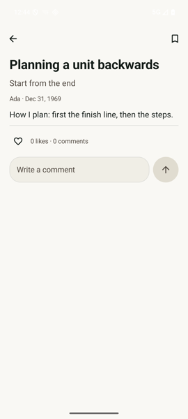 | iOS: 20pt padding; glass circle back/menu, floating glass action pill (padding 48 horizontal) and a Subscribe pill; jam label caps + title. Android: top bar back + bookmark, text scroll, engagement at end. | iOS circle 44 glass; Android bare icon 56dp. iOS author card 20 radius. Android none. | iOS quick post: title2 bold + title3 subtitle; article: size+12 bold, subtitle size+2, byline avatar + subheadline semibold name + secondary. Android: 28sp bold title, 18sp subtitle, one 14sp grey byline, body 18. | Same tokens (text, secondary). iOS Subscribe capsule accent, 50 high. | iOS: toolbar hides on scroll 0.2s, find-in-post, article font picker (faces, sizes). Android: none. | iOS: byline avatar, Edited date, series part, Share button, Subscribe card, find, text size. Android: Edit/Delete/Report text buttons, View band, photos in text. | large: no article typography controls, no byline avatar, no floating action pill |
| Comments and likes (engagement) | Features/Jam/JamEngagement.swift:15-210 | source only |  | iOS: heart + comment in a row with equal-width 44-high slots; composer field 14/10 pad, send circle 40 in 44. Android: 48dp targets, composer field min 56, send circle 56 (shot shows 56). | iOS field radius 20, 12 for reply pill. Android field 24, reply bar 12. | iOS count caption 12 monospaced digit; comment name footnote semibold 13, body 17, reply caption semibold. Android count 14, name 14 semibold, text 16, reply 14. | iOS heart filled = Theme.heart #B3261E/#FFB4AB; send accent when ready, hairline when not. Android heart danger; send accent/pressed. | iOS: light haptic on like. Android: none seen (unverified). Failed send shows retry in both. | iOS: threads indented 12 with a 1pt line; "Waiting for X's phone". Android: indent 32dp; pending label. iOS dark engagement variant over video. Same report/delete. | small: sizes and radius only |
| Your jam (my page: posts, drafts, subscribers, switcher) | Features/Jam/JamPage.swift:9, JamReader.swift:410-430, JamDrafts.swift:95-160, OrgProfile.swift:285-300 | source only | 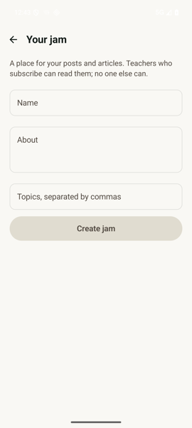 | iOS has no "Your jam" screen: your profile is its page (posts, drafts as a feed segment with 52 thumbnails, subscribers list, band rows). Android: separate screen: title 22 bold, switcher pill, fields, drafts, subscribers, End jam. | Android fields 56 min outlined; iOS surface-fill 14 radius. Android button 26 radius, 52 high. | Android Section 18 semibold, rows 16-17. iOS rows body 17, headers subheadline semibold grey. | Android create button = chip fill. iOS primary = accent capsule. | none seen on either | Android model (separate screen, create form, End jam, switcher sheet) is a different IA from iOS (jam made on first post). | large: different structure, iOS has no standalone screen |
| Write / compose (post composer, step 2 "before you publish") | Features/Jam/JamComposeSheet.swift:142-470, BeforePublish.swift:50-115 | source only | source only | iOS: title "Step 1 of 2"; step 2 thumbnail 72x72 (12 radius), 20 pad, Publish button 50 high accent capsule, option rows 52. Android: top bar title 20sp + Next text button; step 2 rows 52, no thumbnail. | iOS thumbnail 12, cover 14; Android photo tiles 88 with 12, toolbar tools 48 with 12. | iOS title2 bold field, subtitle body grey, placeholder token. Android 20/18 sp, hints textSecondary. Row 17 same. | iOS Publish accent 100%, 40% disabled. Android: Next is text, no accent button (unverified for step 2 button). | iOS: caret/co-edit presence, glass format toolbar. Android: simple toolbar. | iOS: cover picker, co-authors, transcripts, band review "send for review", article mode. Android: photos with alt text, post-as picker, audience line. | large: co-authors, covers, review flow missing |
| Band page (tabs Posts/Info/Members/Groups, subscribe pill, role) | Features/Jam/OrgProfile.swift:4-5, 400-480, 580-615 | source only | 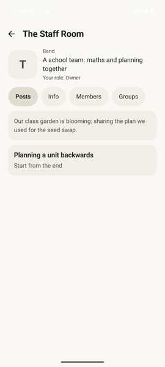 | iOS: full-bleed cover hero, 104 tile avatar, white centred title2 on scrim, subscribe pill 44 high, glass tabs; tabs Info/Posts/Articles/Podcasts (+Members, Groups for members). Android: 72dp tile left, label "Band", "Your role", scroll pills Posts/Info/Members/Groups. | iOS tile radius 104*0.28 (29), Android 20. iOS Info cards 20 radius, rows 58 min; Android post cards 16. | iOS title2 semibold; Android 22 bold top bar. | iOS subscribe: accent or surface capsule; Android same (accent/surface, 24 radius). Android cover-less, no white-on-scrim text. | iOS: glass tabs; Android none. | iOS Posts split into Articles and Podcasts tabs, owner sees Waiting-for-review. Android: one Posts list; role line only on Android. | large: no hero cover, tab set and layout differ |
| Band members and invite | Features/Jam/OrgMembers.swift:60-170 | source only | 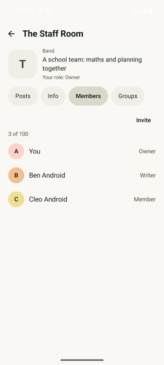 | iOS: grouped by role, rows 56 min, 18 side, divider inset 66, avatar 40, ellipsis 44. Android: flat list, rows 56 min, 20 side, role at right; invite as sheet. | iOS Leave button 14 radius, 52 high surface. Android: red text row. | iOS name body 17, section subheadline semibold grey. Android 17 + role 15 grey. | iOS invite Share = accent capsule 48; Android text buttons. iOS QR 200 on white 12. | none | iOS: invite has a QR code, Turn on/off; Android: link text, Share, New, Off. Same actions otherwise. | medium: QR, role groups, capsule buttons |
| Band groups and join dialog | Features/Jam/OrgMembers.swift:180-345 | source only | 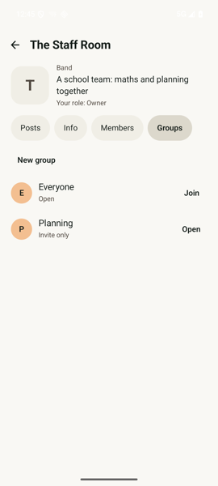 | iOS rows 60 min, 18 side, avatar 40 with initial; "New group" capsule 44; Join = accent capsule 44. Android rows 60 min, 40 avatar, text buttons, join dialog is an AlertDialog. | iOS New-group sheet: name field 52, 14 radius; join is a full screen 24 pad with Join capsule 48x32 wide. | iOS body/caption; "Open / Invite only" caption. Android 17/13. | iOS Join accent; Android text. | none | Same states (asked, joined, full, refused). iOS segmented Open/Invite; Android pills. | small: buttons and dialog style |
| Create band | Features/Jam/CreatePublication.swift:40-140 | source only | source only | iOS: two steps (name/about/photo, then tags); picture 104 with camera badge 34; fields 52 min, 14 radius, tags up to 8. Android: one screen, 104 tile, name counter x/60. | iOS picture radius 29 (0.28); Android 29. Fields iOS 14, Android outlined default (unverified). | iOS body, caption counter, footnote semibold "Band together." Android 22 bold title, 12 counter. | iOS action accent capsule 44 (40% off). Android unverified. | none | iOS step 2 tags up to 8 with custom, "public" note, Band together copy. Android tags unverified. | medium: steps, tags |
| Profile of another person | Features/Profile/ProfileView.swift:466-640, ProfileHero.swift:140-165 | 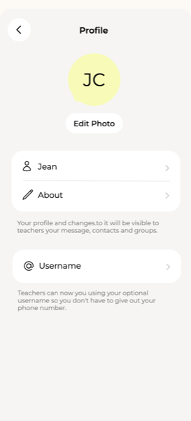 | 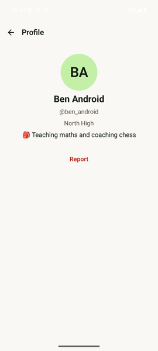 | iOS: hero photo/ambient to 58 % screen, 104 lime-shaped avatar centred at 29 %, tabs and cards; subscribe pill, About card, "On lime since". Android: plain canvas, 96 circle avatar, centred text, red Report. | iOS lime-mask avatar and 20-radius cards; Android circle. | iOS name title2 semibold (22), handle secondary 15; Android 24 bold, 16. | iOS tinted hero; Android flat canvas, red (danger) Report. | iOS living hero / video; Android none. | iOS: status dot, verified seal, shared items, calls, links, orgs; Android: name, handle, school, about, Report/Block. | large: no hero, tabs, shared content |
| My profile (iOS: tap avatar; Android: Settings) | Features/Profile/ProfileView.swift:466-530 | source only | source only | iOS: same hero as other profile with edit pencils, status picker, camera badge. Android: no profile page; Settings holds it (see Settings audit, unverified). | n/a | iOS Add a username etc. secondary | n/a | n/a | Android has no "my profile" screen. | native: Android has Settings; but iOS-style profile page is missing |
| Shell / tab bar (link, call, jam) | App/RootView.swift:206 (system TabView, `.tabBarMinimizeBehavior(.never)`; dock about 282pt wide per CallMiniPlayer.swift:26) |  |  | iOS: system floating capsule on iOS 26; Android: full-width Material NavigationBar (shell/Shell.kt:46). Order differs: iOS link/call/jam, Android Link/Call/Jam enum but verify in shot | iOS glass capsule vs Android flat bar with M3 pill indicator (`colors.pressed`) | Android labels 12sp, default weight; iOS system tab label (unverified size) | Android: bar `surface`, selected `text`, unselected `textSecondary`; iOS system tint (unverified) | iOS system glass/selection; Android M3 indicator ripple | Android Call tab = "Coming soon on Android" text 16sp (Shell.kt:76) | native: bottom NavigationBar is Android idiom; small tweak to colours only |
| Settings main (profile card, rows) | Features/Settings/SettingsView.swift:95-140, 191-250 | 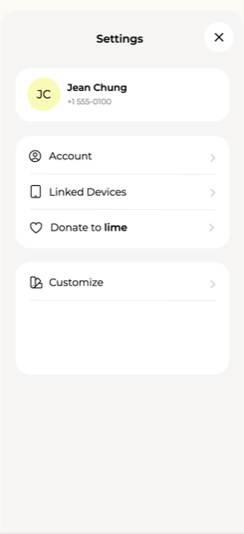 | 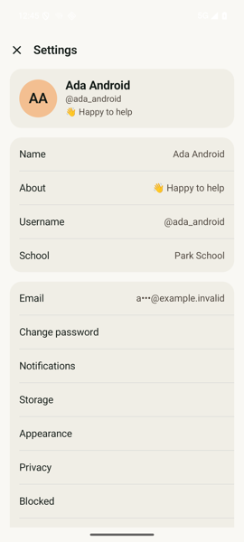 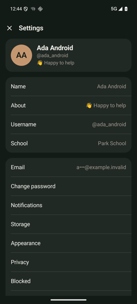 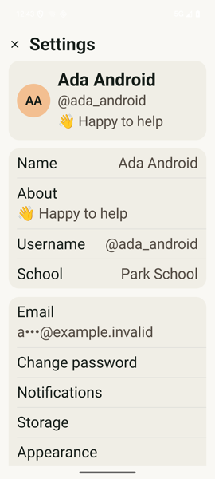 | iOS: 9 grouped cards of icon+title rows linking to sub-screens, 16 side pad. Android: one flat list, profile fields inline (Name/About/Username/School) then Account items, no icons, 16 side pad | iOS cards radius 24 (:206), Android 20 (Settings.kt:163); iOS row minHeight 58, Android 56 | iOS title `Theme.title` (17 semibold), rows `Theme.body`, header title3 bold; Android header 20sp SemiBold, name 20sp Bold, rows 17sp, values 16sp | same tokens (surface, text, textSecondary, hairline) | iOS chevron 13pt on rows; Android has no chevron | iOS has Emergency, My GIFs, Linked Devices, Donate, Work hours, Calls, Customize, Moderation rows; Android none of these (grep: no Emergency in ui/) | large: restructure into iOS grouping with icons and chevrons |
| Account (email, change password) | Features/Settings/AccountScreens.swift | source only |  | iOS own Account screen; Android shows email and Change password as rows in main list | Android fields RoundedCornerShape 16dp (:163); iOS fields 16 (OnboardingComponents.swift:128) | Android error 15sp; iOS `Theme.secondary` (subheadline) | same danger token (unverified values) | unverified | Both: current password, code, new password flow (Android model.back/code steps). Detail unverified | small: move into an Account sub-screen |
| Notifications | Features/Settings/NotificationScreens.swift:19-171 | source only | 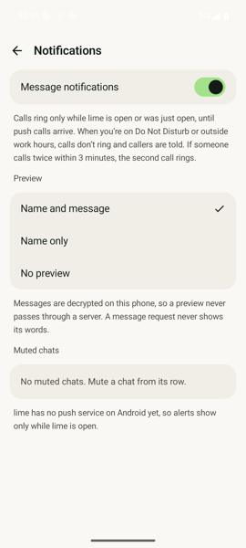 | Row heights iOS 58 toggle, 54 choice, 18 h-pad; Android 58/54, 18 h-pad (SettingsScreens.kt:120,132) | Card iOS 24, Android 20 | Android rows 17sp, mute sub-line 13sp; iOS body / caption | same | iOS native Toggle tint accent; Android M3 Switch track accent, thumb accentInk | iOS has permission prompt sheet ("Turn on notifications" capsule 52 high) and alert-content/sound choices; Android shows only toggles + muted list (unverified full list) | small: card radius, spacing; Android permission screen not verified |
| Storage | Features/Settings/StorageScreens.swift:51-167 | source only | 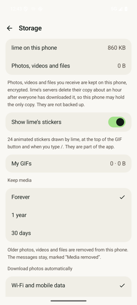 | Rows min 54 and 18 pad both; iOS adds per-chat file browser (row 58, select mode, bulk Delete) | Card 24 vs 20 | iOS body/secondary/caption; Android 17sp value 17sp (iOS value body); gif row | same | Android uses AlertDialog to confirm remove (:318); iOS unverified | iOS: per-file browser; Android: per-chat Remove + keep-media options + My GIFs clear | medium: file-level browser missing |
| Privacy and lock | Features/Settings/SettingsView.swift:96 route .privacy; screen in AccountScreens.swift (unverified exact lines) | source only | 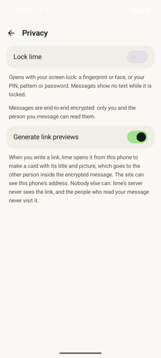 | Same card list with toggles, 18 pad | Card 24 vs 20 | Android 17sp rows, error 15sp | same | M3 Switch vs iOS Toggle | Android has app lock and link previews (SettingsScreens.kt:350); iOS contents unverified | small |
| Appearance / theme / background / text size / typeface | Features/Settings/AppearanceScreen.swift, BackgroundScreen.swift (389 lines), TextSizeScreen.swift:7-90 | source only | 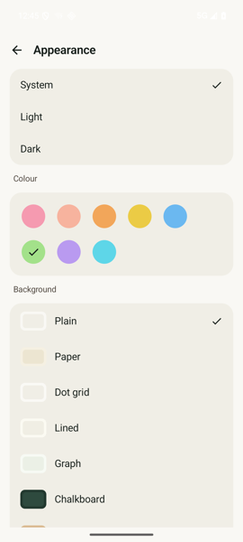 | iOS: Customize hub with live chat preview (height 340), Background screen, Text size slider A..A, Font tab with typeface picker. Android: one Appearance screen (SettingsScreens.kt:382) | Card 24 vs 20 | iOS Text size/Font are in-app overrides (Theme.font); Android none: uses system font scale | same | iOS live preview; Android none | iOS "Use iPhone's text size" toggle + typeface choice: iOS only, not on Android | large: backgrounds, typeface, preview not on Android |
| Blocked people | Features/Moderation (block list) route unverified | source only | 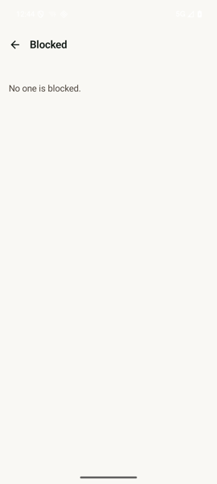 | Android row 17sp + Unblock chip, min 48 | Android chip RoundedCornerShape 24dp (Moderation.kt:247) | Unblock 15sp SemiBold | chip fill `colors.chip` | none | Android has live-region "said" message | small (unverified: iOS source not read) |
| Sounds / Links / App icon / Work hours / Calls / My GIFs / Linked devices | Features/Settings/SoundScreens.swift, LinksScreen.swift, AppIconScreen.swift, CallSettingsScreen.swift | source only | source only | iOS only: not on Android | n/a | n/a | n/a | n/a | n/a | native: app icon and sounds follow Android system; others large if wanted (calls, linked devices) |
| Delete account | Features/Settings/DeleteAccountScreen.swift:76-140 | source only | source only (Android: "Remove everything" = AlertDialog, Settings.kt:155) | iOS: multi-step screen (password, emailed code, confirm), 54-high capsule button. Android: one confirm dialog | iOS fields radius 16, min 56; Android dialog default | iOS title `Theme.title`, code monospaced title3 semibold | danger token | none verified | iOS server-side delete flow with code; Android local "remove everything" (server delete unverified) | large: behaviour differs, may be a privacy gap |
| About | Features/About/AboutView.swift (not read in detail) | source only | 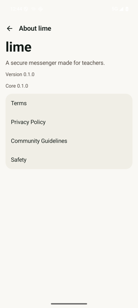 | Android: title 40sp Bold, tagline 17sp, version 15sp, link card rows 56 high, 16 pad | Card 20 vs iOS 24 (unverified for About) | 40sp Bold wordmark vs iOS unverified | same | none | Android shows core version string; iOS unverified | small (unverified) |
| Onboarding: welcome | Features/Onboarding/OnboardingScreens.swift:18-55 | 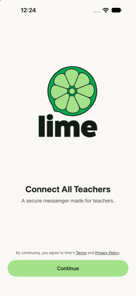 | 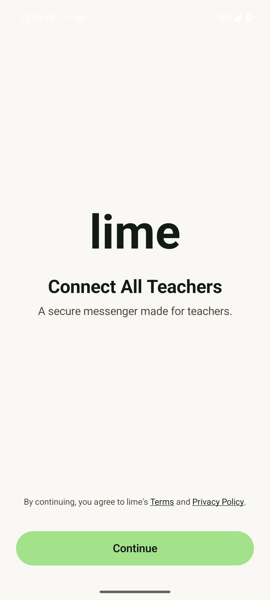 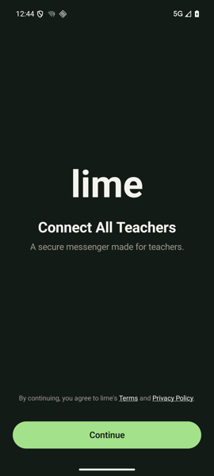 | iOS: lime-slice logo image (max 190x230) above headline; Android: text wordmark "lime" 72sp Bold, no logo. Side pad 24 both; iOS bottom 28 | Button iOS Capsule 54 high; Android RoundedCornerShape 26 min 52 (Components.kt:61) | Headline iOS title bold (28) vs Android 28sp Bold; sub body vs 17sp; terms caption vs 13sp | accent fill same pale lime | none | same text; Android adds test-account trigger | small: swap in logo asset, button 54 |
| Onboarding: identifier | OnboardingScreens.swift:92-125; Components.swift:3-130 | source only | 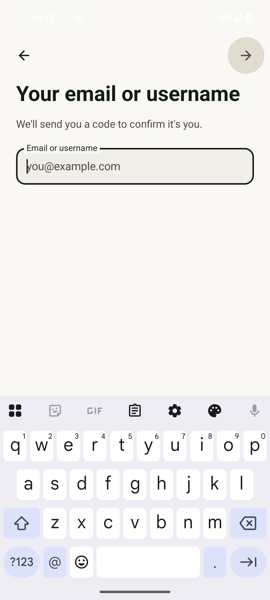 | iOS frame: glass back 48x48 top-left, glass Next capsule (min 72x48) top-right, largeTitle bold; Android: back 56 IconButton, Next circle 56 (Components.kt:79), title 32sp/38 | Field iOS 16 radius, min 52, hairline 0.5; Android 14dp, min 56 | iOS largeTitle (34) bold; Android 32sp Bold | surface fill vs outlined field | none | same steps | small: field radius 14 to 16, Next capsule vs circle |
| Onboarding: confirmation sheet | OnboardingScreens.swift:127-178 | source only | source only | iOS: sheet detents height 320 / large, padding 24, "Yes" capsule 54 + text "Edit" 48; Android ModalBottomSheet containerColor canvas (Screens.kt:88) | iOS sheet radius system; Android M3 sheet default 28 top | detail iOS title3 semibold (~20), Android 20sp SemiBold; question body vs 17sp | canvas background | iOS sheet slide; Android M3 slide | same copy | small |
| Onboarding: password | OnboardingScreens.swift:259-318 | source only | 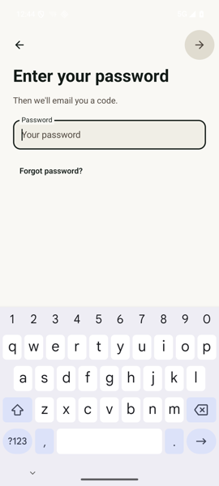 | Show/hide eye 44 iOS; Android hint/mismatch 15sp | Field 16 vs 14 | iOS secondary/subheadline semibold link; Android 15sp SemiBold | same | none | Forgot password link both | small |
| Onboarding: code | OnboardingScreens.swift:180-257 | source only | source only | iOS boxes min height 56, radius 14, monospaced title/title3; Android boxes, text 26sp (20sp if >6 boxes) | iOS 14 radius; Android box shape unverified | iOS monospaced; Android 26sp SemiBold (not monospaced, unverified) | same | none | Resend/Edit links both | small |
| Onboarding: terms | OnboardingScreens.swift:352-405, 408-433 (TermsUpdatedSheet) | source only | source only | iOS toggle-style checkbox row 26pt symbol, min 44; Android agree text 16sp, links 15sp | n/a | iOS body; Android 16sp / 15sp underlined | same | none | iOS also has "The terms changed" sheet (title2 bold); Android equivalent not found (unverified) | medium: terms-updated sheet |
| Onboarding: profile / name step | OnboardingScreens.swift:320-350 | source only | source only | Both: name + username fields; iOS error `Theme.secondary`; Android ErrorText 15sp | same as field (16 vs 14) | same | danger | none | Same flow (Android Screens.kt:312) | small |
| Lock screen | Core/Security/AppLock.swift:209-220 (LockCoverView/LockScreen) | source only | source only | iOS: lock.fill 34pt icon, "lime is locked", Unlock button min 48, padding 24; Android: no icon, title 22sp SemiBold, Unlock capsule min 52, spacing 20 (LockScreen.kt:51) | iOS Unlock shape unverified; Android RoundedCornerShape 26 | iOS Theme.title (17 semibold) vs Android 22sp SemiBold; button 17sp SemiBold | Android canvas bg + accent button | iOS blurred cover while away, window above everything; Android plain canvas cover | Both: cover while away, auto-prompt on lock | small: add icon, title size 17 |
| Call mini-player | Features/Calls/CallMiniPlayer.swift:74-225 | 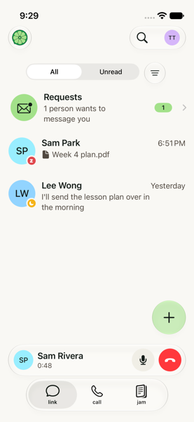 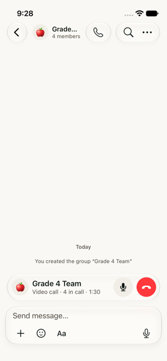 | not built (calls show "Coming soon on Android") | iOS: pill min height 44, avatar 32, buttons 36 (44 hit), width 282 dock, tuck to edge with swipe 60pt | Capsule glass; 26 radius at accessibility size | name body semibold, status footnote | end-call dangerFill, mute pressed | edge tuck gesture | n/a on Android | large: calls not built |
| Moderation: report sheet | Features/Moderation/ReportSheet.swift:43-162 | source only | 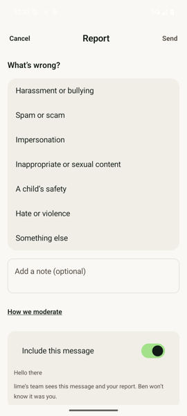 | iOS sheet, padding 16 (24 on done); Android full-screen Dialog (Moderation.kt:95) with Cancel / Report / Send top bar | Options card iOS 16, Android option card 16, include card 16 (:144) | iOS "What's wrong?" headline semibold (17); Android 18sp SemiBold; title 20sp | surface cards, accent toggles | iOS Toggle accent tint; Android M3 Switch dark thumb on lime track (shot) | Same reasons, note, Include this message, Also block, group-include (Android uses text ☑/☐ glyphs at 22sp, :179) | medium: sheet vs full-screen, real checkboxes |
| Moderation: block confirmation | Features/Moderation (confirmation dialog, unverified) | source only | source only | Android AlertDialog (Moderation.kt:199) | M3 dialog default | default M3 | canvas | M3 | iOS unverified | small (unverified: iOS source not read) |
| Moderation screen (staff queue) | Features/Moderation/ModerationScreen.swift:15-100 | source only | not found in Android moderation/Moderation.kt (only report/block) | iOS: Open/Actioned/Dismissed segmented picker, rows min 56, URGENT badge caption2 bold, detail cards | Card 16 | body semibold, caption | surface | none | Staff tool: iOS only; Android none | native: staff queue not needed on Android yet (decide) |
| Bottom sheets and dialogs in general | Theme (28 sheet per Android LimeShapes.kt:25), ios-keep-post-sheet.png, OnboardingScreens.swift:127 | 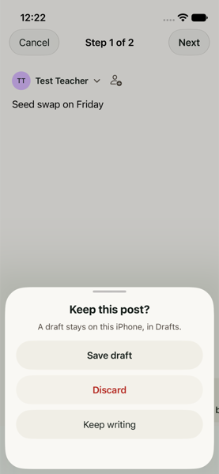 |  | iOS: custom sheet with grabber, title, subtitle, 3 pill buttons stacked; Android: M3 AlertDialog (TextButtons, min 48) and ModalBottomSheet | iOS sheet radius 28, buttons pills on surface fill; Android dialog default M3 (28) with text buttons, new `LimeShapes.sheetTop` 28 unused | iOS title semibold + subtitle caption; Android title default titleLarge | iOS destructive in danger red; Android danger for destructive confirm | iOS spring slide; Android M3 | Android shows confirm as 2 text buttons vs iOS pill stack | medium: build lime sheet using LimeComponents |
| Emergency | Features/Emergency/* (3 files) | source only | source only | iOS only: not on Android (grep of ui/ found no Emergency) | n/a | n/a | n/a | n/a | n/a | native: not built (iOS-only, product decision) |

## Per-part notes (the readers' own "biggest differences")
### Biggest differences (A)

- Chat header: iOS shows avatar, name, status or member subtitle plus search and call circles; Android shows back, avatar and 20sp name only, so chats feel bare and louder in type (20sp vs 15pt).
- Messages top area: iOS has logo, glass search/avatar bubble, segmented All|Unread and glass filter circle, soft scroll edge, 64pt glass plus; Android has a text wordmark, flat pills and a 56dp solid FAB.
- Swipe and row actions: iOS has coloured full-swipe Read/Unread and Pin and red/orange Delete/Mute; Android uses swipe-right read only and a sheet for the rest (native, but the first-touch feel differs).
- Thread screen is read-only on Android (no composer, reactions, edit, find; 18dp bubbles) while iOS reuses the full chat bubble and actions.
- Group info and group create: iOS has cover hero, edit mode, shared media, photo avatar and mute/pin; Android is a plain list with cards and an emoji-only field.

### Biggest differences (B)
- Reactions: iOS uses 30pt round chips overlapping on the bubble edge with a "+N" and a full emoji picker plus a reactors sheet; Android uses plain pills under the bubble and has no "more emoji" button or reactors list.
- In-chat find does not exist on Android (iOS has a find bar, debounce, current/other match highlights).
- Formatting: iOS shows a separate floating glass capsule with quote, headings and Button; Android puts a smaller strip inside the card (adds undo/redo, no quote/headings/Button).
- Type and colour: iOS chat text is Dynamic-Type body 17 and the send button uses the own-bubble green (E4F9BE); Android message text is 16sp and send uses the stronger accent A3E18A. The new LimeType/LimeShapes/LimeSpacing tokens are not used in chat yet.
- Long-press: iOS lifts the bubble with a reaction row and an icon menu; Android shows a plain text bottom sheet (native pattern is fine, but icons and the lifted-bubble are missing). Voice and file cards are bare on Android but sit in a 22pt bubble on iOS. Note: the named iOS shots are not in the android-audit folder, so all iOS facts here are from source only.

### Biggest differences (C)
- Article cards and reader: iOS shows a cover card (photo or tint, white title over gradient), a floating glass action pill, article font picker and byline avatar; Android shows plain text with a 28sp title and one grey byline line.
- Band page: iOS has a full-bleed cover hero, 104pt tile, white-on-scrim title, glass tabs, Articles and Podcasts tabs and a review queue; Android is a flat 72dp tile and pill tabs.
- Profile of another person: iOS has a hero (58% of screen), lime-shaped 104 avatar, cards and shared items; Android is a centred 96dp circle on plain canvas.
- Feed chrome: iOS uses glass capsules, edge fades and Drafts/Discover segments; Android uses solid pills (18dp radius, filled), a text title row and a filter sheet. Android LimeType/LimeShapes tokens are not used by these screens yet (hard-coded sp/dp).
- Your jam is a separate Android screen with create form and End jam; iOS has none (profile is the jam page). Compose lacks co-authors, covers and review. ios-profile.png was not on disk.

### Biggest differences (D)
- Settings main is structurally different: iOS has grouped icon rows with chevrons that open sub-screens (Account, Privacy, Customize, Moderation, Emergency, Calls, Linked Devices...) in 24-radius cards; Android is one flat text list in 20-radius cards with inline profile editing and no icons.
- Customization depth: iOS Appearance has background screen, live preview, in-app text size and typeface (TextSizeScreen.swift); Android has a single Appearance screen and none of these.
- Delete account: iOS is a multi-step flow (password, emailed code, confirm); Android is a single "Remove everything" dialog (server-side delete unverified).
- Sheets and dialogs: iOS custom 28-radius sheets with pill buttons (and the report as a sheet); Android uses Material AlertDialog / full-screen Dialog. The new LimeShapes.sheetTop and LimeComponents are not used yet.
- Onboarding frame details: iOS shows the lime-slice logo and Next capsule, field radius 16, primary button 54; Android shows a "lime" text wordmark at 72sp, Next circle 56, field radius 14, button 52 min.

